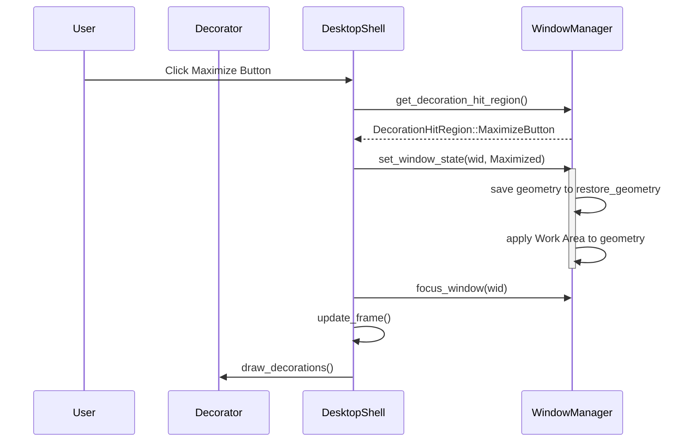
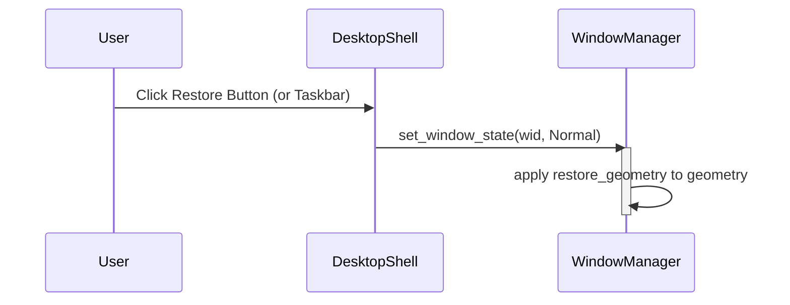

# Window Maximization & Restore Geometry (Implementation 0.8.0.8)

## Overview
Window Maximization introduces geometry transitions beyond basic resizing. In VynexOS, a maximized window expands to fill the **Work Area**, which is the total screen area excluding the Taskbar. 

This implementation adheres to the architectural philosophy where:
* `DesktopShell` orchestrates the input routing and high-level logic (interpreting hits on the Maximize button).
* `BasicWindowManager` strictly owns window state transitions and persistent geometry.

## Desktop Work Area
The **Work Area** is the region of the screen available for normal windows to occupy when maximized.
- Total screen dimensions: `1920x1080`
- Taskbar dimensions: `1920x40` (bottom anchored)
- Work Area: `1920x1040` (starting at `0,0`)

`IWindowManager` was extended to include `set_work_area()` and `get_work_area()`, allowing the `DesktopShell` to specify this region during runtime initialization.

## State Transitions
Windows use a persistent property called **Restore Geometry** (`std::optional<WindowGeometry>`) to remember their bounds before a state transition.

### Maximization Sequence
When a window transitions from `Normal` to `Maximized`, the `BasicWindowManager`:
1. Saves the current `geometry` into `restore_geometry`.
2. Updates `geometry` to match `m_work_area`.
3. Sets `state` to `WindowState::Maximized`.

### Restoration Sequence
When a window transitions from `Maximized` to `Normal`, the `BasicWindowManager`:
1. Checks if `restore_geometry` has a value.
2. Applies the `restore_geometry` back to `geometry`.
3. Sets `state` to `WindowState::Normal`.

## Constraints
To maintain physical invariants, interaction mechanics are strictly constrained for maximized windows:
1. **Dragging Disabled:** Clicking the TitleBar does not capture the pointer for dragging.
2. **Resizing Disabled:** Moving the cursor to the window border does not trigger resize handles.
