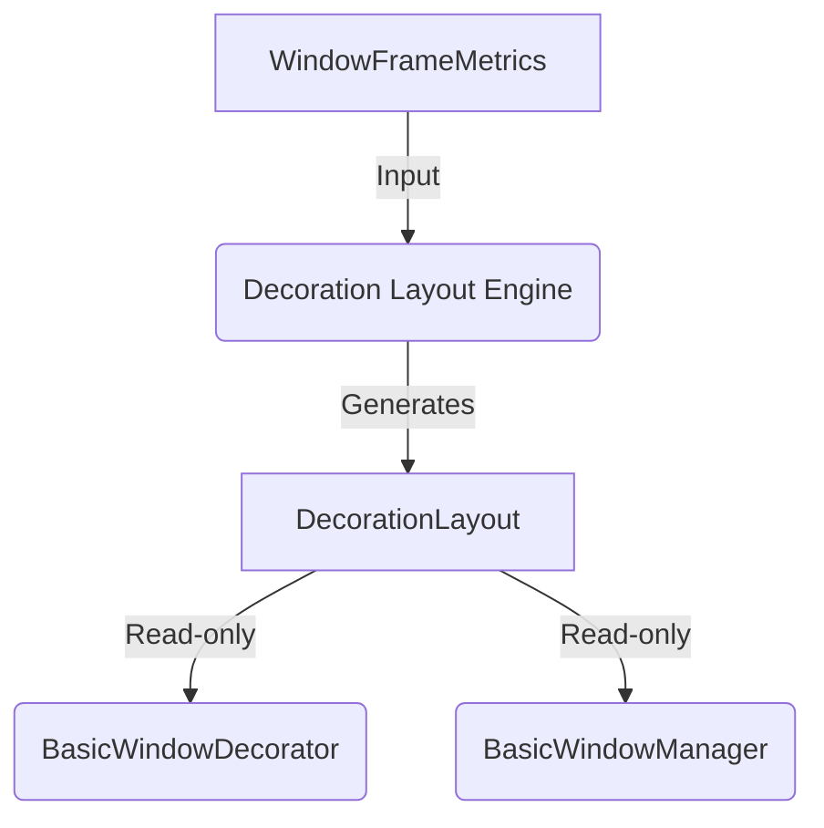

# Decoration Layout Engine

The Decoration Layout Engine is the single authoritative source of truth for the geometric layout of window decorations in VynexOS. 

## Architectural Purpose
Prior to version 0.8.0.9, decoration math (e.g. title bar width, button positions, border coordinates) was duplicated between the renderer (`BasicWindowDecorator`) and the input hit-testing system (`BasicWindowManager`). This led to desynchronization.

The `Decoration Layout Engine` permanently resolves this by calculating [[Shared Decoration Geometry]] exactly once based on [[Window Frame Metrics]]. 

## Consumer Flow

- **Hit Testing:** Consumes the `DecorationLayout` to determine exactly what the user clicked.
- **Rendering:** Consumes the `DecorationLayout` to draw exactly where the hit-regions are defined.

This guarantees perfect alignment between what the user sees and what they interact with, laying the groundwork for custom themes, accessibility, and DPI scaling without coordinate fragmentation.
