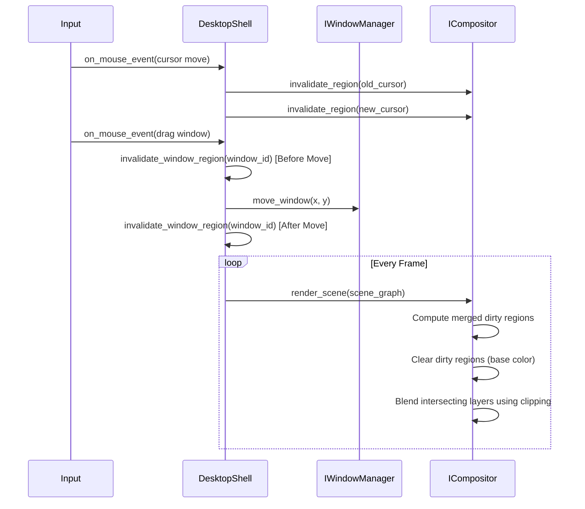
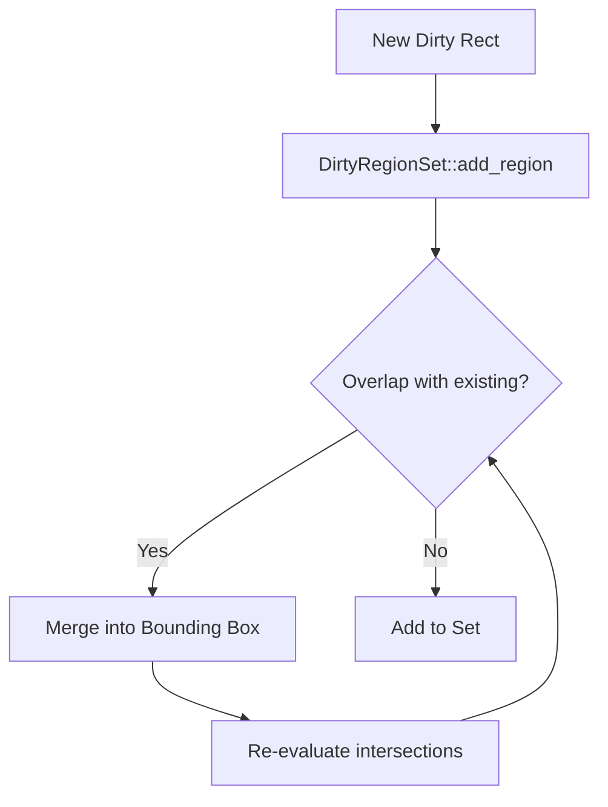

# Desktop Rendering Pipeline

The VynexOS desktop rendering pipeline was modernized in version 0.8.0.9 to use a partial redraw (dirty region) optimization strategy. This structure allows for true decoupling. A future hardware-accelerated compositor could completely replace `[[BasicCompositor]]` without modifying a single line of the shell or window manager.

### Decoration Layout
As part of the pipeline, window decorations are strictly bounded by the [[Decoration Layout Engine]]. The decorator simply consumes a `DecorationLayout` struct containing absolute bounds for title bars, buttons, and borders. No rendering code performs layout geometry calculation.

## Architectural Separation of Concerns

1. **`DesktopShell`**: The orchestrator. Owns input routing, focus management, and event handling. It determines *when* state changes and triggers `invalidate_window_region()` or `invalidate_region()` on the Compositor. It ensures invalidations happen both *before* and *after* any geometric or state change.
2. **`BasicWindowManager`**: Maintains the layered scene graph, geometric bounds, and window states. Completely independent from rendering logic.
3. **`BasicCompositor`**: Receives invalidation requests, accumulates dirty rectangles in `DirtyRegionSet`, merges overlapping rectangles, and performs constrained clipping/blending during `render_scene_internal()`.

## Composition Loop

## Dirty Region Merging

To prevent redundant clearing and overdraw, overlapping dirty regions are merged before rendering.

When rendering, `BasicCompositor` iterates through the merged dirty regions. It clears the master framebuffer only within these regions. For each layer in the Scene Graph (from bottom to top), it calculates the intersection between the layer's bounds and each dirty region, and strictly bounds its pixel copy operations to that intersection.
