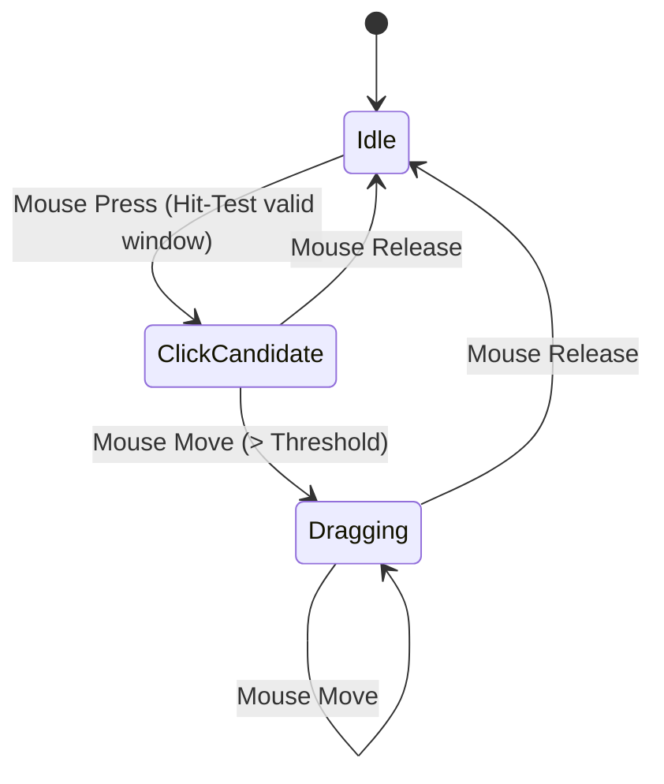

# Drag Architecture

VynexOS implements interactive window movement by strictly separating runtime orchestration (owned by `DesktopShell`) from persistent spatial geometry (owned by `IWindowManager`).

## Drag Lifecycle

The dragging interaction is completely event-driven via the `HAL_INPUT_MOUSE` topic on the `EventBus`.

### 1. Drag Candidate Preparation
When a mouse button is pressed (`button_state` goes from 0 to 1), `DesktopShell`:
1. Queries `IWindowManager::get_window_at(x,y)`.
2. If a valid application window is clicked, focuses it.
3. Queries `IWindowManager::get_window_geometry(window_id)` to capture the window's starting coordinates.
4. Stores `initial_mouse_x`, `initial_mouse_y`, `initial_window_x`, and `initial_window_y` in its internal `DragState`.
5. Keeps `pointer_captured` false.

### 2. Drag Threshold & Pointer Capture
If the mouse moves while the button remains pressed:
1. `DesktopShell` calculates the distance between the current mouse coordinates and `initial_mouse`.
2. If `abs(delta_x) > kDragThreshold` or `abs(delta_y) > kDragThreshold` (where `kDragThreshold = 3`), `pointer_captured` is set to true.
3. Once captured, mouse events are routed exclusively to the dragged window, even if the cursor temporarily leaves the window's bounding box.

### 3. Window Movement Calculation
Once the pointer is captured, every subsequent mouse move updates the window position:
1. `delta_x = mouse_x - initial_mouse_x`
2. `delta_y = mouse_y - initial_mouse_y`
3. `DesktopShell` calls `IWindowManager::move_window(window_id, initial_window_x + delta_x, initial_window_y + delta_y)`.
4. `IWindowManager` handles the persistence of the new coordinates and maintains Z-order.

### 4. Drag Completion
When the mouse button is released (`button_state` goes from non-zero to 0):
1. `DesktopShell` clears `DragState` by setting `window_id = std::nullopt` and `pointer_captured = false`.
2. Normal hit-testing routing resumes.

## Separation of Concerns Rationale
By maintaining the transient `DragState` inside `DesktopShell`, we prevent polluting `IWindowManager` with interaction logic. `IWindowManager` does not know what a "drag" is; it only knows how to move a window. This preserves the absolute authority of `IWindowManager` over layout, while allowing `DesktopShell` to provide complex, stateful interaction models like Pointer Capture.
