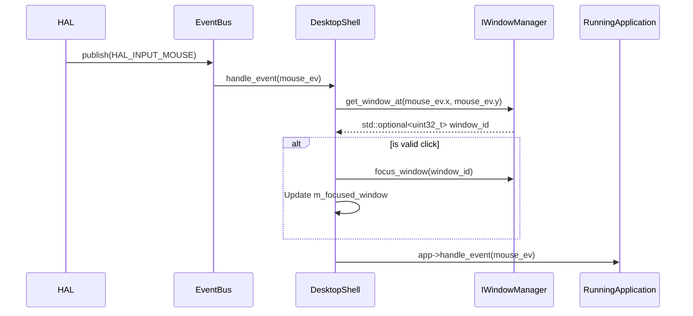
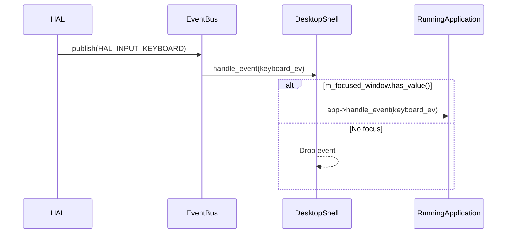

# Event Routing Architecture

The event routing pipeline in VynexOS is designed to guarantee deterministic input delivery while maintaining strict separation of concerns between spatial geometry (Window Manager) and runtime execution (Desktop Shell).

## Input Subsystems

Input begins at the Hardware Abstraction Layer (HAL). The `CompositionRoot` instantiates the appropriate `IInputDriver` (e.g., SDL2) which polls the hardware and emits normalized `core::Event` structures (e.g., `HAL_INPUT_MOUSE`, `HAL_INPUT_KEYBOARD`) onto the `EventBus`.

## Mouse Routing Pipeline

Mouse events are spatially dependent. The `DesktopShell` does not understand window geometry, so it relies on the `IWindowManager` to perform hit testing.

**Key Constraints:**
- Mouse events are NEVER broadcast. They are delivered exclusively to the `RunningApplication` corresponding to the hit-tested window.
- The `IWindowManager` iterates its internal Z-order from top to bottom (front to back) to determine the correct window.

## Keyboard Routing Pipeline

Keyboard events are spatially independent but focus-dependent. 

**Key Constraints:**
- Keyboard events are NEVER broadcast.
- If no window holds focus (`DesktopShell::m_focused_window` is `std::nullopt`), keyboard events are dropped.

## Rationale: Separation of Concerns

Why does `IWindowManager` do hit testing, but `DesktopShell` routes the event?
1. **Geometry Ownership:** `IWindowManager` owns the `WindowGeometry` and Z-order. Only it can accurately determine which window covers a specific coordinate.
2. **Runtime Ownership:** `IWindowManager` has no concept of an `IApplication`. It only sees `ISurface` buffers. Therefore, it cannot route events to an application. `DesktopShell` owns the `RunningApplication` struct, which bridges the gap between the `window_id` and the `IApplication*`.
