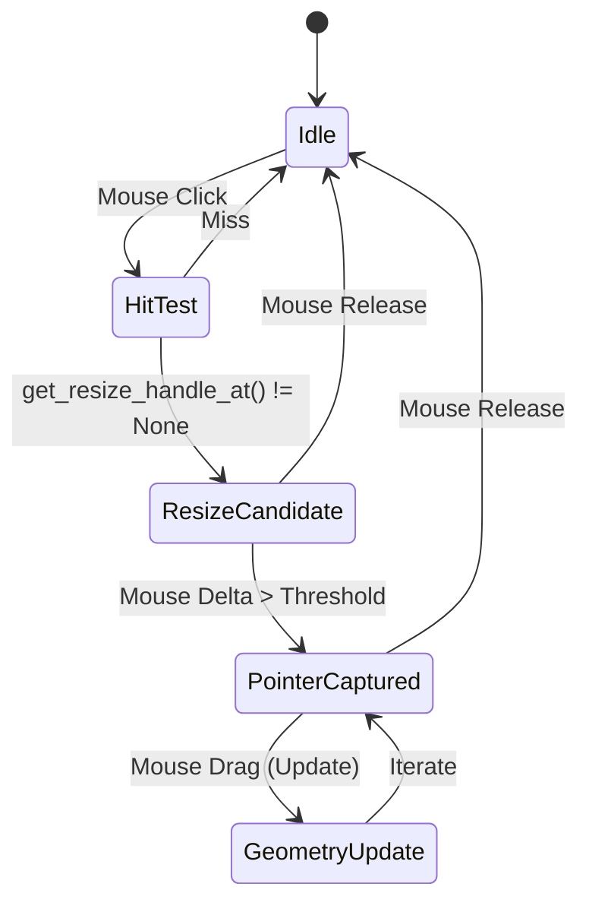

# Window Resizing Architecture

## Overview
Implementation 0.8.0.4 introduces interactive window resizing while strictly preserving the separation of concerns between `DesktopShell` and `IWindowManager`.

## Architectural Boundaries

### DesktopShell (Interaction Owner)
- **Role**: Orchestrates the resize interaction lifecycle.
- **Responsibilities**:
  - Receives and routes `HAL_INPUT_MOUSE` events.
  - Queries `IWindowManager` for resize candidates using `get_resize_handle_at()`.
  - Maintains `ResizeState` (initial coordinates, target window, pointer capture flag).
  - Calculates movement deltas (`delta_x`, `delta_y`).
  - Dispatches `set_window_geometry` commands.
- **Constraints**: Never directly inspects window rectangles or enforces spatial bounds.

### BasicWindowManager (Geometry Owner)
- **Role**: Maintains the definitive source of truth for window spatial properties.
- **Responsibilities**:
  - Implements `get_resize_handle_at()` to perform hit-testing against a defined border thickness (e.g., 5px).
  - Validates and enforces dimensional constraints (e.g., `min_width`, `min_height`).
  - Implements `set_window_geometry()` to atomically apply new bounds, preventing tearing or transiently invalid state.
- **Constraints**: Ignorant of mouse pointer logic, dragging thresholds, and pointer capture state.

## State Machine (Resize Lifecycle)

## Atomic Geometry Updates
Resizing from the Top or Left edge inherently modifies both the position (`x`, `y`) and the dimensions (`width`, `height`). To prevent tearing across the rendering pipeline, `IWindowManager` exposes `set_window_geometry()` to perform these operations atomically within a single mutex lock.
