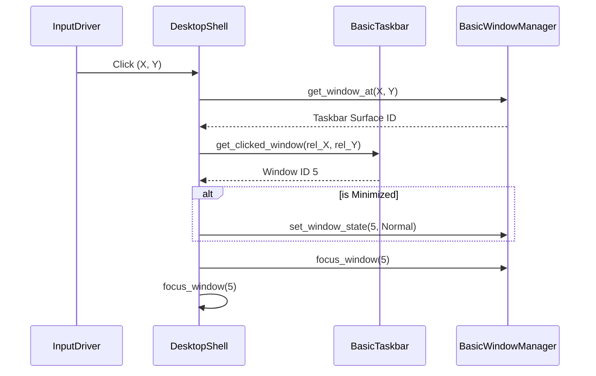

# Taskbar Architecture

## Overview
The **Taskbar Subsystem** introduced in VynexOS 0.8.0.7 is responsible for presenting a visual representation of all running user applications. It allows users to track running programs, identify the currently focused window, and restore minimized applications.

## Architectural Principles
In accordance with the strict responsibilities established in VynexOS:
1. **DesktopShell**: Orchestrates runtime behavior, performs focus routing, and synchronizes the taskbar state with the window manager.
2. **BasicWindowManager**: Owns all persistent window metadata, state, geometry, and Z-ordering.
3. **Taskbar (ITaskbar)**: A purely presentational component. It renders buttons and responds to local click coordinates, but it **never directly mutates window state or focus**.

## Component Interactions


## Enumeration API
`BasicWindowManager` provides an enumeration API that isolates internal structures from presentation components:
```cpp
std::vector<WindowSnapshot> get_window_snapshots() const;
```
This API returns a list of windows strictly ordered by their **creation time**. This ensures that taskbar buttons remain stable on the screen even when the window Z-order continuously changes due to focus switching.

## Rendering
The Taskbar operates in its own dedicated layer in the Desktop scene graph. It is never merged directly with the wallpaper or window contents. `BasicTaskbar` performs software rendering for its UI using `IWidgetToolkit`, presenting customized visual states (Active, Minimized, Inactive) based on the synchronized `TaskbarEntry` model.

## Related Topics
- [[Window Switching]]
- [[Window Activation]]
- [[Desktop Composition]]
- [[Taskbar Rendering]]
